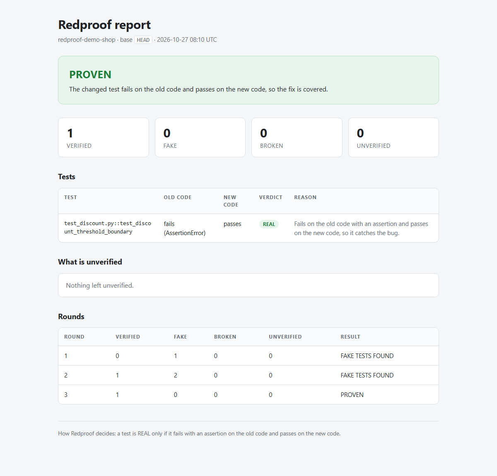
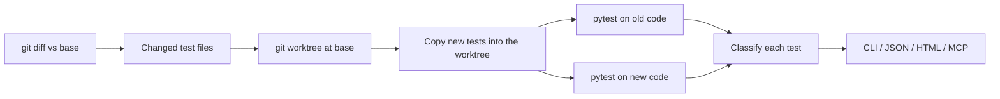

# Redproof

A referee for AI-written tests: proves your tests would actually catch the bug.

[Live example report](https://itsabhishekkashyap.github.io/redproof/example-report.html)



## The problem

An AI agent fixes a bug and writes a test. CI is green, the coverage number goes up, and the fix looks done. But the test can pass even when the bug is still there.

The demo shop had a discount bug: orders of exactly 100 should get 10% off, but the code only applied the discount above 100. A typical weak test for that fix looks like this:

```python
def test_discount_returns_something():
    assert apply_discount(150) is not None
```

It passes with the bug and without it. Line coverage still counts the pricing lines as covered, because the test calls them. Coverage measures which lines ran, not whether the test would notice a wrong answer.

## The idea

The real bug is the perfect test of your test.

Redproof puts the old code back, copies the new tests into it, and runs them. If a test only passes because the bug was fixed, it is doing its job. If it passes on the buggy code too, it is not.

| Verdict | Meaning |
| --- | --- |
| REAL | Fails on the old code with an assertion and passes on the new code. The test catches the bug. |
| FAKE | Passes on the old code and the new code. It cannot catch this bug. |
| INCONCLUSIVE | Could not run on the old code: import error, fixture error, timeout, or another non-assertion failure. It proves nothing. |
| BROKEN | Does not pass on the new code. |

Import errors are INCONCLUSIVE on purpose. A test for a function added by the fix cannot run on the old code, because the function does not exist there. That test proves nothing about whether the bug was fixed, and calling it REAL would reward tests that only touch new code.

## Why this matters for Alan

From Alan's testing evidence docs:

> A report that says what is unverified is more useful than one that claims a clean pass.

Source: [Testing evidence](https://docs.tryalan.ai/docs/reviews-testing-deploys/testing-evidence)

Redproof decides what is unverified. It separates tests that catch the bug from tests that merely run.

## Demo: an Alan agent fixes its own fake test

An Alan agent with the Redproof skill and MCP tool worked on the demo shop. The user sent:

> I fixed the discount bug in shop/pricing.py and wrote a test. Verify my tests are real before we finish.

The demo starts the way an agent often leaves a fix: the bug is fixed and there is one weak test, `assert apply_discount(150) is not None` (planted by `demo/make_demo.py --scenario loop`). The Alan agent called Redproof, which flagged that test as FAKE. The agent added a test, but the second round still had fake tests. On the third round, it left one boundary test that fails on the old code:

```python
from shop.pricing import apply_discount


def test_discount_threshold_boundary() -> None:
    # 100 is the boundary the bug affected: it must already qualify for 10% off.
    assert apply_discount(100) == 90.0
    assert apply_discount(150) == 135.0
    assert apply_discount(99.99) == 99.99
```

The three rounds, from `docs/example-history.jsonl`:

| Round | Result | Verified | Fake |
| --- | --- | --- | --- |
| 1 | FAKE_TESTS_FOUND | 0 | 1 |
| 2 | FAKE_TESTS_FOUND | 1 | 2 |
| 3 | PROVEN | 1 | 0 |

The full report is in `docs/example-report.html`, and the live version is at [itsabhishekkashyap.github.io/redproof/example-report.html](https://itsabhishekkashyap.github.io/redproof/example-report.html).

## Quick start

```bash
pip install git+https://github.com/ItsAbhishekkashyap/redproof
cd your-repo
redproof check --base main
```

Machine-readable output:

```bash
redproof check --base main --json
```

HTML report:

```bash
redproof check --base main --html report.html
```

Exit codes:

| Code | Meaning |
| --- | --- |
| 0 | PROVEN |
| 1 | FAKE_TESTS_FOUND or BROKEN_TESTS |
| 2 | UNVERIFIED or NOTHING_TO_CHECK |
| 3 | Usage error: bad repo path, not a git repository, or unknown base ref |

`--base` is any git ref with the old code. If the fix is not committed yet, `--base HEAD` compares the working tree with the last commit. If the bug was fixed on a branch, use the base branch, for example `--base main`.

## Use it in Alan

Add the MCP server under Settings -> Plugins -> MCP -> Add custom connector, then the **Command** tab:

- Command: `redproof-mcp`
- Fallback: command `python`, arguments `-m redproof.mcp_server`

Import the skill from:

```
https://github.com/ItsAbhishekkashyap/redproof/tree/main/skills/redproof
```

Full connector and setup details: [docs/ALAN_SETUP.md](docs/ALAN_SETUP.md).

Automation recipe: create an Alan automation with the trigger **Pull Request Opened** and the instruction:

> Run redproof check --base <PR base> and comment the result on the PR.

## How it works



The pytest plugin records each test's phase, outcome, and exception type, so Redproof never parses terminal text. Classification is a small set of rules over those records.

Redproof does not modify the user's files or git state. It creates one temporary worktree, removes it in a `finally` block, and prunes it. There is no LLM inside the judge; the verdict comes from running tests.

## Results

Six eval cases, each a small repository with a bug fix and a candidate test:

| case | expected | Redproof verdict | correct? | changed-line coverage | coverage approves? | seconds |
| --- | --- | --- | --- | --- | --- | --- |
| boundary_real | REAL | REAL | yes | 100.0% | yes | 4.62 |
| boundary_fake | FAKE | FAKE | yes | 100.0% | yes | 4.85 |
| mock_fake | FAKE | FAKE | yes | 0.0% | no | 5.23 |
| recompute_fake | FAKE | FAKE | yes | 100.0% | yes | 4.50 |
| raises_real | REAL | REAL | yes | 66.7% | no | 6.77 |
| new_function_inconclusive | INCONCLUSIVE | INCONCLUSIVE | yes | 33.3% | no | 4.76 |

Fake tests: coverage approved 2 of 3. Redproof flagged 3 of 3. Redproof correct on 6 of 6 cases. Median time per case: 4.80 s.

Changed-line coverage is measured with `coverage.py` over the lines touched by `git diff -U0 HEAD`. Coverage approves a test at 90% or more. It approved the boundary fake and the recompute fake because both call the real function; it missed that neither can detect a wrong answer. Redproof caught all three.

The project suite has 52 tests. Run it with:

```bash
python -m pytest -q
```

## How I built it with Alan

I built this solo in about 24 hours inside Alan, using Alan's agent with DeepSeek V4.1 Flash. The work went in phases: core engine, CLI and HTML report, MCP server and skill, then eval and docs. Each phase was planned first, tested, and committed separately; the commit history in this repository shows that sequence. I tested the MCP server over real stdio and ran the full agent loop in Alan.

## Thought process

I considered and dropped three other ideas:

- A memory MCP server. BetterMemory already does this.
- A security scanner for AI-built apps. Several exist, and the full scope needed days.
- Test-tamper scanners. Proctor and AgentTestGuard exist.

The gap I found was narrower: checks that the old code makes the new test fail existed only as one-off CI scripts inside single repositories. They were not reusable tools, and they had no agent loop around them. Redproof is that check as a tool an agent can call.

## Limits

- Bug fixes only. A test for a brand-new feature comes out INCONCLUSIVE, because the feature did not exist in the old code.
- Python and pytest only.
- Flaky tests can still fool it. A test that passes by luck on the new code and fails by luck on the old code will look REAL.
- The eval cases were written by me. They are not an independent benchmark.

## What's next

- Mutation checks on the changed lines, to catch tests that assert too little.
- JavaScript support.
- A GitHub Action that comments Redproof's result on pull requests.

## License

MIT. See [LICENSE](LICENSE).